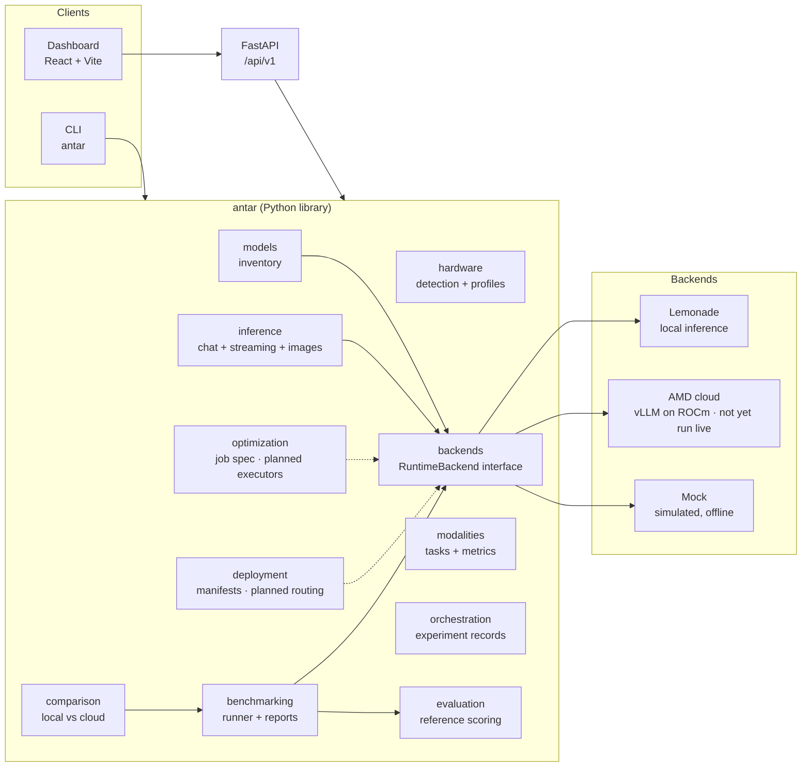

# Antar (अन्तर)

**Cloud-scale intelligence. Local freedom.**

Antar is an open-source platform for optimizing, benchmarking, and deploying multimodal AI
models across the distance between cloud GPUs and the device in front of you. *Antar* is
Sanskrit for "difference" or "the space between" — the gap this project exists to close.

> **Status: pre-alpha.** Real local inference works today through Lemonade: text chat with
> streaming, image understanding, and repeatable benchmarks. Cloud inference on AMD GPUs
> through vLLM, and a local-versus-cloud Comparison Lab, are **implemented with mocked tests
> and have not yet run on real AMD hardware**. No optimization or deployment exists. See
> [Current implementation status](#current-implementation-status) for exactly what is and is
> not built.

## The problem

The most capable models need more memory and compute than a laptop or edge device has.
Developers who want to run them locally face a pile of manual work: guess which techniques
apply (quantization? distillation? adapters?), try them one at a time, and hope quality
survived. Results are rarely measured the same way twice, so they are hard to trust or
reproduce. And when a model simply cannot fit, there is no principled way to fall back to
the cloud.

Antar's goal is to turn that into one measured, reproducible pipeline:

1. Accept a model and a target workload.
2. Identify the available cloud and local hardware.
3. Measure baseline quality and performance.
4. Determine which optimization techniques apply.
5. Run the selected experiments.
6. Benchmark the optimized candidates.
7. Compare quality, latency, throughput, and memory.
8. Select a configuration that satisfies your constraints.
9. Export reproducible deployment artifacts and reports.

## Architecture



Solid lines are implemented; dashed lines are defined interfaces with no execution behind
them yet. The AMD cloud line is implemented and tested against a stand-in server, and has
not yet carried a request to a real GPU. More detail in
[docs/architecture/overview.md](docs/architecture/overview.md) and
[docs/architecture/cloud-execution.md](docs/architecture/cloud-execution.md).

## Why AMD Lemonade is central

[Lemonade](https://lemonade-server.ai) is the local half of the cloud-to-edge story. It is
a local AI server with an OpenAI-compatible API that already manages model download,
loading, and hardware-specific inference engines across text, vision, speech, and image
models. Antar deliberately does **not** reimplement any of that. Instead it treats Lemonade
as the deployment target: the thing an optimized model must run well *on*, and the runtime
whose measured behaviour decides whether an optimization was worth it.

The cloud half is AMD Instinct GPUs through ROCm. Large-model inference runs there through
a self-hosted vLLM server that you start; fine-tuning and distillation are meant to follow.
Antar can also register that server with Lemonade's own experimental cloud routing, so
Lemonade stays the one place models are listed. Antar stays portable: nothing in the
base install is AMD-specific, and local development works on an Apple Silicon Mac with no
cloud access.

## Key capabilities

| Capability | State |
|---|---|
| Lemonade connectivity, model discovery, load, and confirmed download | Working |
| Text chat with streaming, cancellation, and separate reasoning output | Working |
| Image understanding with a vision-language model | Working |
| Per-request metrics from the backend's own timings | Working |
| Benchmark runner: three text workloads and a basic vision workload | Working |
| Benchmark reports with JSON and CSV export, manual review, and comparison checks | Working |
| Live telemetry, with unavailable measurements labelled | Working |
| Local hardware detection | Working (GPU enumeration: macOS only) |
| Explicit capability discovery per backend, including what is *not* supported | Working |
| Mock backend for offline development | Working (text only, clearly simulated) |
| Reference-answer scoring: exact match, numbers, JSON fields, unit-tested code, image questions | Working (small CC0 prompt sets) |
| Unified model registry: where each model runs, who serves it, and its state | Working |
| AMD cloud inference through vLLM: text and vision chat, streaming, cancellation | Implemented, mocked tests. **Not yet run on AMD hardware** |
| Host preflight, `amd-smi` GPU readings, memory feasibility estimate | Implemented, mocked tests. **Not yet run on AMD hardware** |
| Comparison Lab: local versus cloud, with JSON, CSV, and Markdown export | Implemented. Tested end to end against stand-in servers |
| Cloud cost estimate, time budget, and confirmation before cloud use | Working (operator-entered price; no billing API) |
| Registering the endpoint as a Lemonade cloud provider | Checked against a real Lemonade with a stand-in server, not vLLM |
| Broader quality evaluators (perplexity, WER, labelled datasets) | Not built |
| Optimization executors (LoRA/QLoRA, distillation, quantization) | Not built |
| Local/cloud routing and deployment | Not built |
| Speech, image generation, video | Not built (interfaces only) |

## Installation

Requirements: Python 3.11+, [uv](https://docs.astral.sh/uv/), Node 22+, and
[pnpm](https://pnpm.io). A GPU is not required.

```bash
git clone https://github.com/ashutoshjoshi1/Antar.git
cd Antar
uv sync                          # backend (no PyTorch, no GPU stack)
cd apps/web && pnpm install      # dashboard
```

Inference needs [Lemonade](https://lemonade-server.ai) running locally with at least one
model downloaded. Antar looks for it at `http://localhost:13305/v1`; without it the
dashboard still runs and says plainly that the server is unreachable. Antar never downloads
a model unless you confirm it. Full instructions:
[local inference walkthrough](docs/phase1-local-inference.md),
[local setup](docs/installation/local.md), [AMD cloud walkthrough](docs/phase2-amd-cloud.md).

## Quick start

```bash
# Terminal 1: API on http://localhost:8080
uv run antar serve

# Terminal 2: dashboard on http://localhost:5173
cd apps/web && pnpm dev
```

From the command line:

```bash
uv run antar system                       # detected hardware, as JSON
uv run antar backends                     # is Lemonade reachable?
uv run antar models                       # models reported by reachable backends
uv run antar mock-generate "hello"        # simulated output from the mock backend

# Real inference through the API (the model must already be downloaded in Lemonade)
curl -N localhost:8080/api/v1/inference/chat/stream -H 'Content-Type: application/json' \
  -d '{"model": "Qwen3-1.7B-GGUF", "messages": [{"role": "user", "content": "Say hello."}]}'
```

Then open the dashboard: **Playground** for text, **Vision** for images, **Benchmarks** to
measure a model. API reference: [docs/api.md](docs/api.md), or `http://localhost:8080/docs`.

### Cloud (optional)

Cloud inference needs an AMD GPU host that you provision and a vLLM server that you start
on it. Antar never starts, stops, or bills anything. Without a host, everything below still
runs and reports the cloud as not configured.

```bash
uv run antar cloud-estimate Qwen/Qwen3-32B --gpu-memory-gb 192   # will it fit? (arithmetic)
uv run antar cloud-preflight                                     # read-only host check over SSH

# After starting vLLM on the host and opening the tunnel (scripts/cloud/):
export ANTAR_CLOUD__BASE_URL=http://127.0.0.1:18000/v1
export ANTAR_CLOUD__API_KEY=...
uv run antar cloud-status
```

The procedure, in order: [Phase 2 walkthrough](docs/phase2-amd-cloud.md),
[host setup](docs/cloud/amd-setup.md), [ROCm and vLLM](docs/cloud/rocm-vllm.md),
[secure access](docs/cloud/secure-access.md),
[comparison methodology](docs/benchmarks/local-vs-cloud.md).

## Current implementation status

Antar is honest about its own state by design: the API reports support levels
(`supported`, `documented`, `planned`, `unsupported`) and the dashboard labels anything
unfinished as "Not built yet".

**Works today**

- Text and image-understanding chat through Lemonade, streamed, cancellable, with the
  measurements Lemonade reports for each response
- Model explorer: what is downloaded and loaded, with load, unload, and confirmed download
- Benchmark runner with four built-in workloads, cold-start measurement, saved reports,
  JSON/CSV export, manual review of answers, and a check for unfair comparisons
- System page with live telemetry
- Automatic scores for six small reference-answer workloads, including image questions and
  text in images; open-ended answers are still reviewed by a person
- Verified against a real Lemonade 2026.46.2 server on an Apple M3 Pro, including opt-in
  live tests (`uv run pytest -m lemonade_live`)
- 315 backend tests and 85 frontend tests; ruff, mypy (strict), ESLint,
  and `tsc` in CI

**Implemented, not yet run on real AMD hardware**

- The `amd_cloud` backend for a self-hosted vLLM server: status, model discovery, text and
  vision chat, streaming, cancellation, timeouts, authentication and out-of-memory errors
- Operator scripts for the host (`scripts/cloud/`), a read-only preflight, GPU readings
  from `amd-smi`, and a memory feasibility estimate
- Comparison Lab, experiment history, exports, cost estimates, and time budgets
- Opt-in live tests (`uv run pytest -m amd_live`) that have **not** been executed

All of this is exercised by tests against stand-in servers. The request and response
details come from the vLLM and AMD documentation as of 2026-11-18, and some of them are
unconfirmed until they meet a real server; the list is in
[docs/phase2-amd-cloud.md](docs/phase2-amd-cloud.md#remaining-live-verification).

**Does not exist yet**

- Any optimization or deployment. The Optimization page builds and validates a job
  specification only.
- Any benchmark number. There are no results in this repository, local or cloud.
- A general measure of answer quality. The automatic scores check a response against a
  reference by a fixed rule on small prompt sets; nothing judges open-ended answers except a
  person, and there is no LLM judge.
- Per-request memory, or local GPU utilization and power. Cloud GPU readings are
  device-level, for the whole GPU. Where a value cannot be read, Antar says "unavailable".
- Any way to start, stop, or pay for a cloud machine. That is always you.
- Speech, image generation, and video. Lemonade documents no video endpoint at all.

## Roadmap

See [docs/ROADMAP.md](docs/ROADMAP.md). The next step is live verification of the cloud
path on a real AMD GPU host, then the first optimization: a measured comparison of
quantization levels of one model, scored the same way on both sides.

## Contributing

Contributions are welcome — see [CONTRIBUTING.md](CONTRIBUTING.md) and the
[developer guide](docs/developer-guide/setup.md). Two rules matter more than any style
guide: never commit a number that was not measured, and never claim a capability that does
not work. Please report security issues privately, per [SECURITY.md](SECURITY.md).

## License

[MIT](LICENSE). Antar is an independent open-source project and is not affiliated with or
endorsed by AMD. AMD, Instinct, ROCm, and Ryzen are trademarks of Advanced Micro Devices,
Inc.
