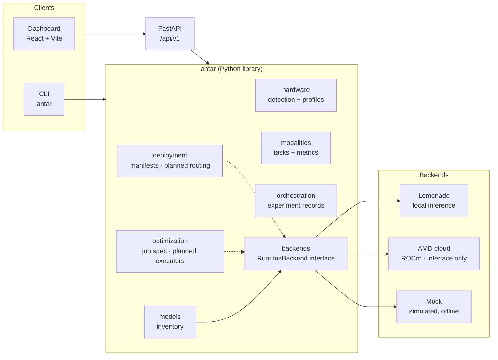

# Antar (अन्तर)

**Cloud-scale intelligence. Local freedom.**

Antar is an open-source platform for optimizing, benchmarking, and deploying multimodal AI
models across the distance between cloud GPUs and the device in front of you. *Antar* is
Sanskrit for "difference" or "the space between" — the gap this project exists to close.

> **Status: pre-alpha foundation.** The API, dashboard, hardware detection, Lemonade model
> discovery, and a mock backend work today. **No optimization, benchmarking, or deployment
> runs yet.** See [Current implementation status](#current-implementation-status) for exactly
> what is and is not built.

## The problem

The most capable models need more memory and compute than a laptop or edge device has.
Developers who want to run them locally face a pile of manual work: guess which techniques
apply (quantization? distillation? adapters?), try them one at a time, and hope quality
survived. Results are rarely measured the same way twice, so they are hard to trust or
reproduce. And when a model simply cannot fit, there is no principled way to fall back to
the cloud.

Antar's goal is to turn that into one measured, reproducible pipeline:

1. Accept a model and a target workload.
2. Identify the available cloud and local hardware.
3. Measure baseline quality and performance.
4. Determine which optimization techniques apply.
5. Run the selected experiments.
6. Benchmark the optimized candidates.
7. Compare quality, latency, throughput, and memory.
8. Select a configuration that satisfies your constraints.
9. Export reproducible deployment artifacts and reports.

## Architecture



Solid lines work today; dashed lines are defined interfaces with no execution behind them
yet. More detail in [docs/architecture/overview.md](docs/architecture/overview.md).

## Why AMD Lemonade is central

[Lemonade](https://lemonade-server.ai) is the local half of the cloud-to-edge story. It is
a local AI server with an OpenAI-compatible API that already manages model download,
loading, and hardware-specific inference engines across text, vision, speech, and image
models. Antar deliberately does **not** reimplement any of that. Instead it treats Lemonade
as the deployment target: the thing an optimized model must run well *on*, and the runtime
whose measured behaviour decides whether an optimization was worth it.

The cloud half is AMD Instinct GPUs through ROCm, where compute-heavy work (fine-tuning,
distillation, large-model baselines) is meant to run. Antar stays portable: nothing in the
base install is AMD-specific, and local development works on an Apple Silicon Mac with no
cloud access.

## Key capabilities

| Capability | State |
|---|---|
| Five modalities (text, vision, speech, image, video) with per-modality tasks and metrics | Catalog defined |
| Explicit capability discovery per backend, including what is *not* supported | Working |
| Local hardware detection | Working (GPU enumeration: macOS only) |
| Lemonade connectivity and model discovery | Working |
| Mock backend for offline development | Working (text only, clearly simulated) |
| Typed specs: model, hardware, optimization job, benchmark, evaluation, deployment | Defined and validated |
| Reproducible experiment record format with filesystem store | Working |
| Inference through Lemonade | Not built |
| Optimization executors (LoRA/QLoRA, distillation, quantization) | Not built |
| Benchmark runner and evaluators | Not built |
| AMD cloud remote execution | Not built (config validation only) |
| Local/cloud routing | Not built |

## Installation

Requirements: Python 3.11+, [uv](https://docs.astral.sh/uv/), Node 22+, and
[pnpm](https://pnpm.io). A GPU is not required.

```bash
git clone https://github.com/ashutoshjoshi1/Antar.git
cd Antar
uv sync                          # backend (no PyTorch, no GPU stack)
cd apps/web && pnpm install      # dashboard
```

Lemonade is optional but recommended — install it from
[lemonade-server.ai](https://lemonade-server.ai). Antar looks for it at
`http://localhost:13305/v1` and reports it as unavailable, without failing, if it is not
running. Full instructions: [local setup](docs/installation/local.md),
[AMD cloud setup](docs/installation/amd-cloud.md).

## Quick start

```bash
# Terminal 1: API on http://localhost:8080
uv run antar serve

# Terminal 2: dashboard on http://localhost:5173
cd apps/web && pnpm dev
```

From the command line:

```bash
uv run antar system                       # detected hardware, as JSON
uv run antar backends                     # is Lemonade reachable?
uv run antar models                       # models reported by reachable backends
uv run antar mock-generate "hello"        # simulated output from the mock backend
curl localhost:8080/api/v1/capabilities   # what each backend supports
```

API reference is served at `http://localhost:8080/docs`.

## Current implementation status

Antar is honest about its own state by design: the API reports support levels
(`supported`, `documented`, `planned`, `unsupported`) and the dashboard labels anything
unfinished as "Not built yet".

**Works today**

- `GET /health`, `/api/v1/system`, `/api/v1/backends`, `/api/v1/models`,
  `/api/v1/capabilities`, `/api/v1/settings`, `/api/v1/experiments`
- Dashboard pages backed by live API data: Overview, Models, Hardware, Settings
  (Benchmarks and Deployments read live data too, but have nothing to show yet)
- Lemonade adapter verified against a real Lemonade 2026.46.2 server on macOS
- 76 backend tests and 23 frontend tests; ruff, mypy (strict), ESLint, and `tsc` in CI

**Does not exist yet**

- Any real inference, optimization, benchmark, or deployment. The Optimization page builds
  and validates a job specification only.
- Any measured result. There are no benchmark numbers in this repository, and none will be
  added that were not produced by a recorded experiment.
- Video support in any backend. Lemonade documents no video endpoint.

## Roadmap

See [docs/ROADMAP.md](docs/ROADMAP.md). The next milestone is the first real vertical
slice: text chat inference through Lemonade plus a performance benchmark that writes a
genuine experiment record.

## Contributing

Contributions are welcome — see [CONTRIBUTING.md](CONTRIBUTING.md) and the
[developer guide](docs/developer-guide/setup.md). Two rules matter more than any style
guide: never commit a number that was not measured, and never claim a capability that does
not work. Please report security issues privately, per [SECURITY.md](SECURITY.md).

## License

[MIT](LICENSE). Antar is an independent open-source project and is not affiliated with or
endorsed by AMD. AMD, Instinct, ROCm, and Ryzen are trademarks of Advanced Micro Devices,
Inc.
