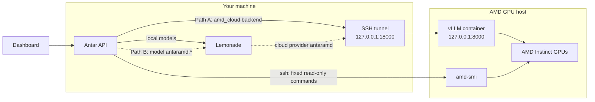

# Cloud execution architecture

> Implemented with mocked tests; not yet exercised against a real AMD host. See
> [Phase 2](../phase2-amd-cloud.md).

## Shape

Antar runs on your machine. The cloud model runs in a vLLM server you started on a host
you provisioned. Antar reaches it one of two ways.

**Path A** is Antar's own adapter and the required path. **Path B** registers the same
endpoint with Lemonade's experimental cloud routing; Lemonade then lists and relays the
models itself and Antar sees them as Lemonade models that run in the cloud. Antar adds no
routing of its own on Path B and does not modify Lemonade.

Execution is separate from optimization: nothing in `antar/optimization/` is involved.

## Modules

| Module | Role |
|---|---|
| `antar/backends/amd_cloud/config.py` | `AmdCloudProfile` (SSH host), `CloudEndpointSettings` (endpoint and the allowlist rule), `CloudModelConfig`, `CloudCostSettings` |
| `antar/backends/amd_cloud/vllm.py` | `VllmClient`: `/health`, `/version`, `/v1/models`, chat, streaming |
| `antar/backends/amd_cloud/backend.py` | `AmdCloudBackend`: adapts the client to `RuntimeBackend`, merges served models with the catalog and configuration |
| `antar/backends/amd_cloud/ssh.py` | `SshRunner` and the `RemoteRunner` protocol tests replace |
| `antar/backends/amd_cloud/amd_smi.py` | `GpuMonitor` and the tolerant `amd-smi` JSON parser |
| `antar/backends/amd_cloud/preflight.py` | Runs `scripts/cloud/check_environment.sh` remotely and parses its lines |
| `antar/backends/amd_cloud/feasibility.py` | The memory budget estimate |
| `antar/backends/amd_cloud/cost.py` | `CloudSession`, its file store, and the cost estimate |
| `antar/inference/openai.py` | OpenAI wire-format helpers shared by the Lemonade and vLLM clients |
| `antar/models/catalog.py` | Verified facts about known models |
| `antar/hardware/gpu.py` | `GpuSample`, `GpuReading`: backend-neutral GPU readings |
| `antar/evaluation/scoring.py` | Reference-answer scoring |
| `antar/comparison/report.py` | `ComparisonConfig`, `ComparisonReport`, the row builder, the GPU summary |
| `antar/comparison/manager.py` | Runs a comparison in the background |
| `antar/comparison/store.py`, `export.py` | One JSON file per comparison; CSV and Markdown |
| `apps/api/antar_api/routes_cloud.py`, `routes_comparisons.py` | Thin HTTP handlers |
| `scripts/cloud/` | Operator scripts, run by a person |

`build_backends` in `antar/backends/registry.py` constructs the cloud backend from
settings. It takes an optional HTTP transport and remote runner, which is how every test
runs without a network.

## The backend contract

`RuntimeBackend` (`antar/backends/base.py`) is unchanged in shape. Phase 2 adds one
optional method and the cloud backend's answers to the existing ones.

| Capability | How `amd_cloud` provides it |
|---|---|
| Identity and type | `name = "amd_cloud"`, `kind = cloud` |
| Connection status | `status()`: `not_configured`, `unavailable` with the reason, or `available` with the vLLM version. Never raises |
| Hardware information | `gpu_sample()` — new. Device-level readings, or `None` when the backend has no way to ask |
| Model discovery | `list_models()`: served models, plus declared models that are not being served |
| Model capabilities | `capabilities()` and each model's `modalities` |
| Text and vision generation | `chat()`, `chat_stream()` |
| Cancellation | Closing the stream closes the HTTP connection, which makes vLLM abort the request |
| Performance metrics | `InferenceMetrics` on every result; unavailable fields are `None` |
| Load and unload | `load_model()` only confirms the model is the one being served. Unload and download refuse |

`gpu_sample()` defaults to `None` on the base class, so Lemonade and the mock need no
change. A backend that can ask but got no answer returns a sample whose `unavailable` list
says why.

Capability checks are explicit. The cloud backend refuses an image unless the served model
is known to accept images, and refuses a model that is not being served, both before any
request is sent.

### Capability registry

`capabilities()` on each backend, served together at `GET /api/v1/capabilities`:

| Backend | Text chat | Image understanding | Speech | Image generation | Video |
|---|---|---|---|---|---|
| `lemonade` | supported | supported | documented | documented | unsupported |
| `amd_cloud` | supported | supported | planned | planned | planned |
| `mock` | supported (simulated) | unsupported | unsupported | unsupported | unsupported |

`supported` for `amd_cloud` means the adapter exists and has tests. It has not yet run on
real hardware.

## The model registry

`ModelSpec` (`antar/models/spec.py`) gained five optional fields. As everywhere, `None`
means the source did not say.

| Field | Meaning |
|---|---|
| `location` | `local`, `cloud`, or `mock`: where the computation happens |
| `provider` | Who serves it: `lemonade`, `vllm`, a Lemonade cloud provider name, `mock` |
| `state` | See below |
| `family` | From the catalog |
| `parameter_count` | From published metadata, never estimated |

Existing fields carry the rest: `id`, `name`, `backend`, `modalities`, `tasks`, `revision`,
`checkpoint` (the source), `runtime`, `size_bytes`, `license`, `quantization` (also used
for weight precision such as BF16), `context_length`, `downloaded`, `loaded`.

| State | Meaning | Lemonade | vLLM |
|---|---|---|---|
| `configured` | Declared in Antar's configuration; the backend has not reported it | — | Listed under `cloud.models` but not served |
| `discovered` | Listed by the backend; weights are not on it | In the catalog, not downloaded | — |
| `installed` | Weights present; not in memory | Downloaded, not loaded | — |
| `loaded` | Able to answer now | In memory, or a cloud-provider model | Being served |

Whether a backend can be reached at all is the backend's `availability`, not a model state.

For a served vLLM model, `context_length` is what the server was started with, not the
model's theoretical maximum. Hardware requirements are not a field: they depend on context
and concurrency as well as the model, so they are computed on request by the feasibility
estimate, from the published weight size and architecture and never from the parameter
count alone.

A model vLLM serves that is in neither the catalog nor the configuration is listed with no
modality. vLLM's model list does not say what a model accepts, and Antar does not guess.

## Jobs

There is no queue and no external service. `JobSlot`
(`antar/benchmarking/manager.py`) is one in-process slot shared by `BenchmarkManager` and
`ComparisonManager`. A second job is refused with 409, not queued, because a measurement
needs the hardware to itself. The slot is taken before the first `await` so two requests
cannot both pass the check. While it is held, chat and model actions are refused.

A comparison is an asyncio task. Cancelling sets a flag and cancels the runner, which
abandons the request in flight; the time budget is a timer that does the same. The report
is saved in every outcome. On API shutdown a running comparison is cancelled and awaited.

## GPU monitoring

`GpuMonitor` runs one SSH command per sample (static, metric, and version together) and
returns its cached sample if asked again inside `gpu_poll_interval_seconds`. However often
the dashboard or a comparison asks, the host is polled at most once per interval. An
unreachable host is a sample with no GPUs and the reason attached.

## Cost

`CloudSessionStore` keeps one JSON file, `data/cloud/session.json`, with the hourly price,
credit balance, and instance start and stop times a person entered. `estimate_cost` is
arithmetic on those. There is no provider API anywhere in Antar, and a stop time is only
what the operator said.

## Future cloud workers

**Not built.** Phase 2 runs text and vision-language models through vLLM. Speech
recognition, speech synthesis, image generation, image-to-video, and text-to-video are
declared `planned` on the cloud backend and nothing runs them. No fake implementation
exists.

vLLM is not assumed to run those architectures. Diffusion and audio models need their own
runtimes, and each will be a separate worker. This is the interface such a worker has to
meet; it is recorded here so that Phase 2's structure does not have to change to admit one.

1. **One backend per runtime.** A worker is a `RuntimeBackend` subclass in its own
   `antar/backends/<name>/` package, registered in `build_backends`. It does not extend
   `AmdCloudBackend`. The API, inventory, and dashboard iterate over the registry, so
   nothing else is restructured.
2. **Honest capabilities.** `capabilities()` declares exactly the tasks it executes as
   `supported`, and its models carry the matching `modalities` and `tasks`. The `Modality`
   and `Task` vocabulary already covers all five modalities.
3. **Typed requests and results, added with the first implementation.** `RuntimeBackend`
   has `chat` and `chat_stream` today. The first real speech or image worker adds the method
   for its task (for example `transcribe`, `synthesize`, `generate_image`) with frozen
   request and result models in `antar/inference/`, refusing by default on the base class
   like every other optional method. They are not added before there is code behind them.
4. **Results that are files.** Audio, images, and video are too large for a JSON field.
   A worker returns an artifact reference (path or URL under Antar's control, media type,
   size, SHA-256) and the bytes are stored under `storage.artifacts_dir`, not in reports.
   `ArtifactRef` in `antar/deployment/manifest.py` is the existing type to build on.
5. **Long-running generation as a job.** A video takes minutes. Such a worker exposes
   start, progress, cancel, and result, like `BenchmarkManager`, and holds the `JobSlot`
   or a slot of its own. A request-response call is only suitable for short outputs.
6. **Cancellation that reaches the GPU.** Cancelling must stop the remote computation, not
   only the client's wait.
7. **Metrics for the modality.** Real-time factor for speech, seconds per image or frame
   for generation, with unavailable values as `None`. The metric keys are already in
   `antar/modalities/catalog.py`.
8. **The same security rules.** A configured, allowlisted endpoint; no URL or command from
   a request; inputs validated in memory; nothing private written to logs.
9. **GPU exclusivity.** vLLM reserves most of each GPU's memory when it starts. A second
   runtime on the same GPUs needs vLLM stopped, a lower `--gpu-memory-utilization`, or
   separate GPUs selected with `--gpus`. The worker's deployment must state which, and its
   feasibility estimate must account for it.
10. **Operator-started.** As with vLLM, a person starts and stops the runtime. Antar does
    not launch paid resources.

The Lemonade side already documents speech and image endpoints; adapters for those follow
the same steps and are tracked in the roadmap.
