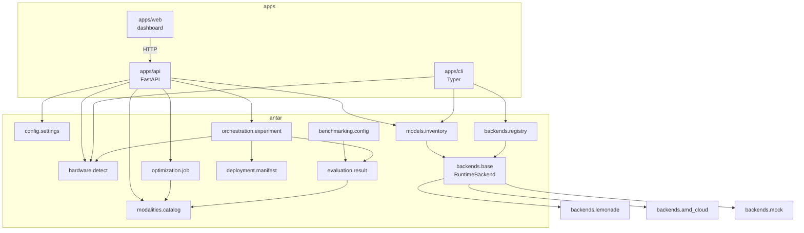
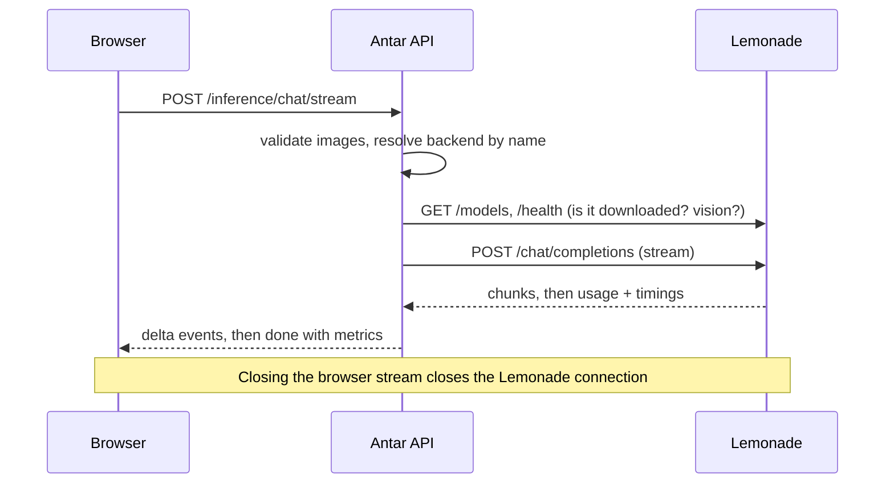

# Architecture

## Principles

1. **The library is the product.** `antar/` holds all logic. The API and CLI are thin
   clients of it, and the dashboard is a client of the API.
2. **Backends are the only extension point that matters today.** Everything that hosts a
   model implements one interface.
3. **Capability is declared, not assumed.** Every backend states what it supports per
   modality, including what it does not.
4. **Unknown stays unknown.** Optional fields are `None` when the source did not report a
   value. Nothing is estimated.
5. **Specs before executors.** Each pipeline stage has a typed, validated specification
   first. Executors are added one vertical slice at a time.

## Components

## The backend contract

`antar/backends/base.py` defines `RuntimeBackend`:

| Method | Contract |
|---|---|
| `status()` | Returns a `BackendStatus`. Must not raise when the backend is unreachable. |
| `capabilities()` | Returns a `Capability` per modality or task with a `SupportLevel`. |
| `list_models()` | Returns `ModelSpec`s, or raises `BackendUnavailableError`. |
| `chat()` / `chat_stream()` | Optional. Text and image-understanding chat. |
| `load_model()` / `unload_model()` | Optional. Must never download. |
| `download_model()` / `downloads()` | Optional. Only called on an explicit user action. |
| `model_processes()` | Optional. Process ids of loaded models, for telemetry. |

Optional methods refuse by default, so a backend cannot appear to support something merely
by existing. Methods for speech, image generation, and video will be added when the first
backend implements them; the modality vocabulary already covers all five.

`chat_stream()` yields `ChatDelta` events and then exactly one `ChatDone`. Closing the
iterator must stop generation in the backend; that is how cancellation works end to end.

`SupportLevel` separates four cases that are easy to blur:

- `supported` — Antar can execute it through this backend now.
- `documented` — the backend documents it, but Antar's adapter does not call it yet.
- `planned` — on the roadmap, nothing wired.
- `unsupported` — the backend does not offer it.

### Adding a backend

1. Create `antar/backends/<name>/` with a class implementing `RuntimeBackend`.
2. Register it in `build_backends()` in `antar/backends/registry.py`.
3. Add settings to `antar/config/settings.py` if it needs configuration.
4. Test `status()` for the unreachable case and `capabilities()` for honesty.

The API, model inventory, CLI, and dashboard iterate over the registry, so no other code
changes.

## Backends today

**Lemonade** (`backends/lemonade/`). `client.py` is a typed async HTTP client: health,
models, stats, load, unload, pull, downloads, and chat completions with and without
streaming. `backend.py` adapts it to `RuntimeBackend`, maps Lemonade's model labels onto
Antar modalities, and enforces the download guard. Text chat and image understanding are
`supported`; everything else Lemonade documents stays `documented`. Unrecognized labels
are preserved verbatim and the model is left unclassified rather than guessed.

Two properties of Lemonade shape the adapter:

- *Implicit downloads.* `/load` and `/chat/completions` fetch a missing model on their
  own. `_require_downloaded` runs before every such call, so a multi-gigabyte download can
  only start from the explicit download action.
- *Per-response timings.* Each completion, and the last chunk of a stream, carries a
  `timings` object for that response. Antar builds per-request metrics from it.
  `/v1/stats` describes the server's most recent request from any client, so it is shown
  only as a server-wide counter and never attributed to a request.

**AMD cloud** (`backends/amd_cloud/`). `AmdCloudProfile` validates a user-declared remote
host: SSH target, ROCm version, GPUs. The backend reports `not_configured` or
`not_implemented` and never opens a connection. Host and user validation rejects values
that could be interpreted as SSH options.

**Mock** (`backends/mock/`). Deterministic simulated text generation for offline
development. Every model and result carries `simulated=True`.

## Inference

`antar/inference/` holds what every backend shares: `ChatRequest`, `ChatResult`,
`InferenceMetrics`, the stream event types, and image validation.

`InferenceMetrics` keeps two clocks apart. `latency_ms` and `first_chunk_ms` are measured
by the Antar API around the HTTP call. `prompt_processing_ms`, `generation_ms`,
`tokens_per_second`, and token counts are reported by the backend for that response. A
field is `None` whenever it was not measured.

Images are validated in memory (declared type, real file signature, size limit) and
forwarded as data URLs. They are never written to disk.

## Benchmarking

`antar/benchmarking/`:

- `workloads.py` — built-in, versioned prompt sets and the bundled CC0 sample images.
- `runner.py` — `BenchmarkRunner` sends requests one at a time through `chat_stream`,
  labelling each as `cold`, `warmup`, or `measured`. A failed request is recorded and the
  run continues; a failed model load fails the run.
- `report.py` — `BenchmarkReport`, the saved artifact, and the statistics.
- `store.py` — one JSON file per report, CSV export, manual review fields.
- `manager.py` — runs one benchmark at a time as a background task and exposes progress.

Statistics are computed over measured requests only. Cancelling stops the request in
flight and saves a report with status `cancelled` containing what finished.

## Telemetry

`antar/hardware/telemetry.py` samples CPU and memory with psutil and tries to read the
memory of each loaded model's process. Whatever cannot be read is returned as an
`Unavailable` entry carrying the reason, and benchmark reports copy that list into
`missing_telemetry`.

## Configuration

`antar/config/settings.py`. Precedence: constructor arguments, `ANTAR_*` environment
variables, `.env`, then the YAML file named by `ANTAR_CONFIG_FILE` (default
`configs/antar.yaml`). Nested keys use a double underscore: `ANTAR_LEMONADE__BASE_URL`.
Secrets are `SecretStr` and reach the API only as booleans.

## Experiment records

`antar/orchestration/experiment.py` defines `ExperimentRecord`, stored as one JSON file per
experiment under `storage.experiments_dir`. See
[the benchmark methodology](../benchmarks/methodology.md) for the fields and the rules
around them.

## HTTP API

Read endpoints from the foundation (`/health`, `/system`, `/backends`, `/models`,
`/capabilities`, `/settings`, `/experiments`) plus model management, inference, telemetry,
and benchmarks. The full list with request shapes is in [the API reference](../api.md).

The API is unauthenticated and intended for localhost. CORS allows only the configured
dashboard origins. Requests select a backend by name; there is no parameter anywhere that
takes a URL, so the only HTTP targets are those in the server's own configuration. Typed
errors map to HTTP statuses in `apps/api/antar_api/main.py`; anything unexpected returns a
generic 500 and is logged server-side.

## Frontend

`apps/web` is a React single-page app. Server state lives in TanStack Query hooks
(`src/lib/api.ts`); response types in `src/lib/types.ts` mirror the API by hand and must be
updated with it. Filters are stored in the URL. In development Vite proxies `/api` and
`/health` to the API, so no CORS configuration is needed.

The Playground and Vision pages share `components/chat/ChatWorkspace`. Streaming uses
`fetch` with a `ReadableStream` (`lib/chatStream.ts`), since `EventSource` cannot POST;
`lib/useChat.ts` owns the conversation, applies tokens once per animation frame, and aborts
the request to cancel. Replies are rendered as plain text, never as HTML.

## Deliberate omissions

- No per-modality or per-technique subpackages until there is code to put in them.
- No database: experiment records and benchmark reports are files.
- No job queue: one benchmark runs at a time, in the API process.
- No endpoints that change configuration: that is done in the environment or YAML.
- No Markdown rendering of model output.
