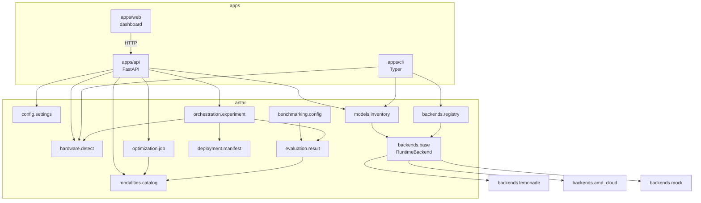

# Architecture

## Principles

1. **The library is the product.** `antar/` holds all logic. The API and CLI are thin
   clients of it, and the dashboard is a client of the API.
2. **Backends are the only extension point that matters today.** Everything that hosts a
   model implements one interface.
3. **Capability is declared, not assumed.** Every backend states what it supports per
   modality, including what it does not.
4. **Unknown stays unknown.** Optional fields are `None` when the source did not report a
   value. Nothing is estimated.
5. **Specs before executors.** Each pipeline stage has a typed, validated specification
   first. Executors are added one vertical slice at a time.

## Components

## The backend contract

`antar/backends/base.py` defines `RuntimeBackend`:

| Method | Contract |
|---|---|
| `status()` | Returns a `BackendStatus`. Must not raise when the backend is unreachable. |
| `capabilities()` | Returns a `Capability` per modality or task with a `SupportLevel`. |
| `list_models()` | Returns `ModelSpec`s, or raises `BackendUnavailableError`. |
| `generate_text()` | Optional. The default raises `CapabilityNotSupportedError`. |

Inference methods are opt-in so that a backend cannot appear to support something merely
by existing. Methods for other modalities will be added to the interface when the first
backend implements them.

`SupportLevel` separates four cases that are easy to blur:

- `supported` — Antar can execute it through this backend now.
- `documented` — the backend documents it, but Antar's adapter does not call it yet.
- `planned` — on the roadmap, nothing wired.
- `unsupported` — the backend does not offer it.

### Adding a backend

1. Create `antar/backends/<name>/` with a class implementing `RuntimeBackend`.
2. Register it in `build_backends()` in `antar/backends/registry.py`.
3. Add settings to `antar/config/settings.py` if it needs configuration.
4. Test `status()` for the unreachable case and `capabilities()` for honesty.

The API, model inventory, CLI, and dashboard iterate over the registry, so no other code
changes.

## Backends today

**Lemonade** (`backends/lemonade/`). `client.py` is a small typed HTTP client for
`GET /v1/health` and `GET /v1/models`; `backend.py` maps Lemonade's model labels onto
Antar modalities. Unrecognized labels are preserved verbatim and the model is left
unclassified rather than guessed. Capabilities are `documented`, not `supported`, until
inference adapters exist.

**AMD cloud** (`backends/amd_cloud/`). `AmdCloudProfile` validates a user-declared remote
host: SSH target, ROCm version, GPUs. The backend reports `not_configured` or
`not_implemented` and never opens a connection. Host and user validation rejects values
that could be interpreted as SSH options.

**Mock** (`backends/mock/`). Deterministic simulated text generation for offline
development. Every model and result carries `simulated=True`.

## Configuration

`antar/config/settings.py`. Precedence: constructor arguments, `ANTAR_*` environment
variables, `.env`, then the YAML file named by `ANTAR_CONFIG_FILE` (default
`configs/antar.yaml`). Nested keys use a double underscore: `ANTAR_LEMONADE__BASE_URL`.
Secrets are `SecretStr` and reach the API only as booleans.

## Experiment records

`antar/orchestration/experiment.py` defines `ExperimentRecord`, stored as one JSON file per
experiment under `storage.experiments_dir`. See
[the benchmark methodology](../benchmarks/methodology.md) for the fields and the rules
around them.

## HTTP API

| Endpoint | Returns |
|---|---|
| `GET /health` | API liveness and version |
| `GET /api/v1/system` | `HardwareProfile` of the API host |
| `GET /api/v1/backends` | `BackendStatus` for each backend |
| `GET /api/v1/models` | Merged model inventory plus per-backend source status |
| `GET /api/v1/capabilities` | Modality catalog, technique applicability, backend capabilities |
| `GET /api/v1/settings` | Effective configuration, read-only, secrets redacted |
| `GET /api/v1/experiments` | Stored experiment records |

The API is read-only, unauthenticated, and intended for localhost. CORS allows only the
configured dashboard origins. OpenAPI docs are served at `/docs`.

## Frontend

`apps/web` is a React single-page app. Server state lives in TanStack Query hooks
(`src/lib/api.ts`); response types in `src/lib/types.ts` mirror the API by hand and must be
updated with it. Filters are stored in the URL. In development Vite proxies `/api` and
`/health` to the API, so no CORS configuration is needed.

## Deliberate omissions

- No per-modality or per-technique subpackages until there is code to put in them.
- No database: experiment records are files.
- No job queue: nothing executes yet.
- No write endpoints: configuration is changed in the environment or YAML.
